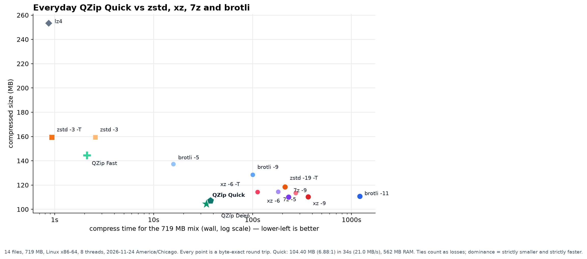
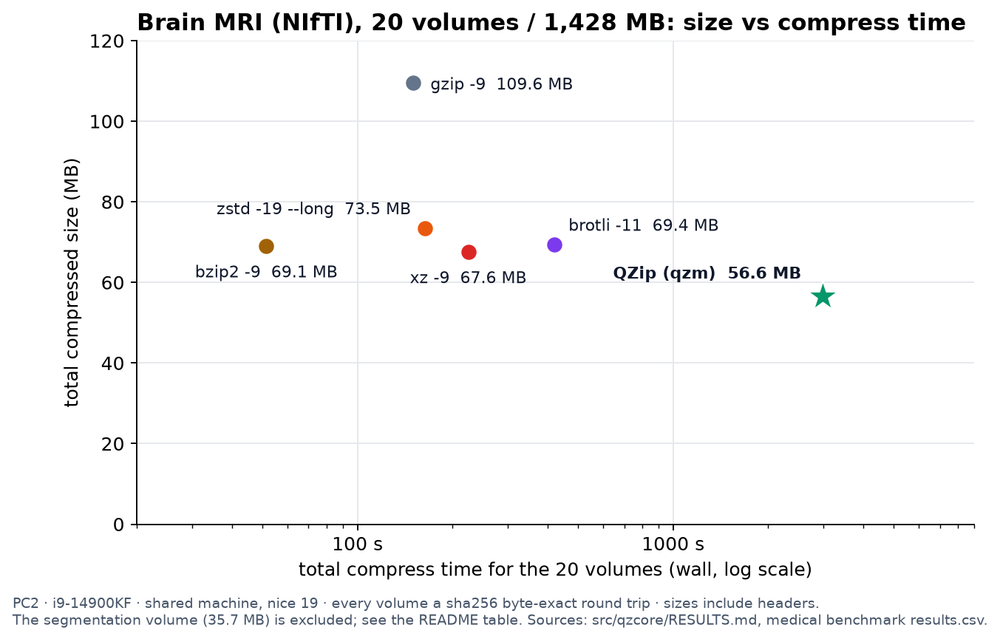
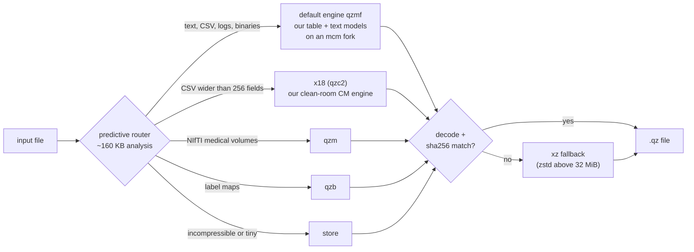

<h1 align="center">QZip — Quick Zip</h1>

<p align="center">
  <b>Verified lossless compression that beats mcm on text and crushes xz and zstd on real-world CSVs.</b><br>
  One command or one drag-and-drop. Every file is decoded and sha256-checked before you get it.
</p>

<p align="center">
  <a href="https://github.com/EHankinson08/QZip/actions/workflows/ci.yml"></a>
  <a href="https://github.com/EHankinson08/QZip/releases/tag/v1.2.0"></a>
  <a href="LICENSE"></a>
  
</p>

<p align="center">
  <a href="#quick-start">Quick start</a> ·
  <a href="#benchmarks">Benchmarks</a> ·
  <a href="#medical-imaging-nifti">Medical imaging</a> ·
  <a href="#how-it-works">How it works</a> ·
  <a href="#faq">FAQ</a> ·
  <a href="docs/BENCHMARKS.md">Full results</a>
</p>

<p align="center"></p>

**New in v1.2: Quick is smallest on all 24 Silesia and Loghub files, and at least as fast to
compress as 7-Zip on every one of them** ([results](#silesia-and-loghub-v12)). Quick has been the
default since v1.1; the 14-file everyday mix from that release still holds
([results](#quick-the-default-since-v11)).

QZip is a context-mixing compressor with models built for tables and text. On public CSV datasets it writes files
**20–26% smaller than mcm** and **1.65–3.8× smaller than xz -9e**, and on Wikipedia text it is **1.03–1.24% smaller
than mcm** and **30–35% smaller than xz, zstd and brotli**. On brain MRI volumes (NIfTI) its own medical codec
writes **16.2% less than xz -9 and about half the size of gzip -9** across 20 volumes, each verified byte-exact.
It ships as a CLI and a local web app, runs entirely on your machine, and never hands you a file it hasn't decoded and verified byte-for-byte.

## Highlights

- **Smaller files.** A table model that learns CSV/TSV columns as it reads them, plus tuned text contexts, on top of a
  proven context-mixing core.
- **Verified by construction.** Every result is decoded and its sha256 compared with the original before it is
  written. If that ever fails, QZip ships xz instead, so you can't get a broken file.
- **Built for medical imaging.** NIfTI volumes go to qzm, QZip's own codec for 3D scans: smaller than gzip, xz,
  zstd, bzip2 and brotli on 20 of 21 brain MRI volumes ([results](#medical-imaging-nifti)).
- **Picks the right engine for you.** A predictive router looks at ~160 KB of the file and chooses one codec. No trial
  encodes, one encode, one verifying decode.
- **Drag-and-drop web app.** `qzip web` opens a local UI on `127.0.0.1`. No account, no API key, nothing leaves your
  machine. Large files run as background jobs with progress and cancel.
- **One portable format.** CLI and web app write the same `.qz` container (a small JSON header plus the raw codec
  output), so either opens the other's files.
- **Honest numbers.** Every figure in this README is a byte-exact round trip with its machine, time and RAM recorded
  ([methodology](docs/BENCHMARKS.md)).

<p align="center"></p>

## Quick start

```bash
git clone https://github.com/EHankinson08/QZip.git && cd QZip
./run_local.sh                       # first run: venv + native build (~1–2 min), then the web app on http://127.0.0.1:5000
.venv/bin/qzip compress data.csv     # in a second terminal: Quick (default) writes data.csv.qz, verified
```

Get the file back with `.venv/bin/qzip decompress data.csv.qz -o restored.csv`, or drop the `.qz` on the web app.

**Requirements:** Linux on x86-64 with AVX2, Python 3.9+, gcc/g++ 13+ and make.

<details>
<summary>Manual install and Docker</summary>

```bash
python3 -m venv .venv && . .venv/bin/activate
pip install -e .          # small default install: numpy, zstandard, Flask, FastAPI (no torch)
make native               # builds the native codecs with the exact flags that were benchmarked
qzip web                  # local web app on http://127.0.0.1:5000
```

Docker: `docker build -t qzip . && docker run --rm -p 127.0.0.1:5000:5000 qzip`
</details>

### CLI

```bash
qzip compress   data.csv                     # Quick (default) -> data.csv.qz (-o to choose the name)
qzip compress   --classic data.csv           # Classic: the v1.0 engine (mcm-fork router / x18), smaller on text and CSVs, much slower
qzip compress   --deep data.csv              # Deep: qze -3 for now (a bigger engine is in development)
qzip compress   --fast data.csv              # zstd-class speed
qzip compress   --max data.csv -o data.max.qz  # QZip's own x18 / qzs codecs: smallest on some files, 3x+ slower
qzip decompress data.csv.qz -o out.csv       # sha256-checked; refuses to overwrite without -f
qzip verify     data.csv.qz data.csv         # decodes and compares with the original
qzip info       data.csv.qz                  # header fields: name, source path, sha256
qzip bench      data.csv                     # QZip vs xz -9 / zstd -19 --long / bzip2 -9 on your file
qzip web                                     # local drag-and-drop web app
```

Modes: `--quick` (default), `--classic` (also `auto`, the v1.0 router), `--deep`, `--fast`, `--max` / `auto-max` (QZip's own codecs only, sometimes smaller, 3–15× slower)
and `auto-fast` (fast codecs only). Details in [docs/USAGE.md](docs/USAGE.md).

## Benchmarks

### Quick (the default since v1.1)

Quick (`qzip compress`, engine `qze -2`) is built for everyday files: fast, parallel, and smaller than the usual
archivers. On a 14-file, 719 MB mix of CSVs, logs, JSON, source tarballs, Wikipedia text, binaries, a SQLite database
and a PDF, **Quick is strictly smaller AND strictly faster to compress than 7z -9, xz -9, brotli -11 and
zstd -19 -T on all 14 files** (ties count as losses).

<p align="center"></p>

| 719 MB mix (14 files, 8 threads) | ratio | total size | compress | decompress | peak RAM |
|---|---:|---:|---:|---:|---:|
| **QZip Quick** | **7.38** | **97.45 MB** | **17.5 MB/s** | 134.8 MB/s | 2.77 GB (CPython tarball; ≤ 0.6 GB on the other 13 files) |
| 7z -9 | 6.52 | 110.22 MB | 2.8 MB/s | 136.8 MB/s | 1.05 GB (CPython) |
| xz -9 | 6.51 | 110.39 MB | 2.0 MB/s | 146.2 MB/s | |
| brotli -11 | 6.49 | 110.70 MB | 0.6 MB/s | 380.5 MB/s | |
| zstd -19 -T | 6.07 | 118.48 MB | 3.3 MB/s | 862.8 MB/s | |

Per file (compressed bytes · compress wall time):

| file | input | **Quick** | 7z -9 | xz -9 | brotli -11 | zstd -19 -T |
|---|---:|---:|---:|---:|---:|---:|
| youth.csv | 55.5 MB | **1,740,984 · 1.71 s** | 3,982,193 · 18.63 s | 3,979,928 · 23.55 s | 3,536,333 · 86.93 s | 3,723,296 · 17.50 s |
| TRI_By_Name_1987_2014.csv | 68.4 MB | **6,040,734 · 2.83 s** | 7,573,058 · 29.07 s | 7,558,064 · 35.93 s | 7,336,137 · 106.13 s | 7,890,413 · 22.09 s |
| Panel_2000_2022.csv | 58.2 MB | **10,756,456 · 2.43 s** | 12,998,566 · 38.29 s | 13,017,752 · 50.70 s | 13,077,822 · 134.30 s | 13,693,727 · 32.17 s |
| ssh.log | 73.4 MB | **868,404 · 0.50 s** | 3,600,499 · 10.89 s | 3,619,968 · 17.88 s | 2,725,964 · 102.13 s | 2,999,081 · 21.78 s |
| openstack.log | 40.5 MB | **1,966,506 · 0.57 s** | 2,530,845 · 5.93 s | 2,517,976 · 8.91 s | 2,323,046 · 58.93 s | 2,432,598 · 21.68 s |
| healthapp.log | 23.5 MB | **1,248,636 · 1.21 s** | 1,494,358 · 4.47 s | 1,496,408 · 7.58 s | 1,311,594 · 35.97 s | 1,434,593 · 16.41 s |
| gh_events.json | 67.1 MB | **4,012,606 · 1.34 s** | 4,203,827 · 11.91 s | 4,195,164 · 14.40 s | 4,053,913 · 60.39 s | 4,645,302 · 8.73 s |
| cpython-3.12.7.tar | 105.7 MB | **19,965,372 · 11.89 s** | 19,983,689 · 31.75 s | 20,045,536 · 41.75 s | 20,279,823 · 149.16 s | 21,001,965 · 16.09 s |
| mixed_pystdlib.tar | 26.6 MB | **5,360,713 · 4.84 s** | 5,383,198 · 5.96 s | 5,389,244 · 9.77 s | 5,487,571 · 44.38 s | 5,913,265 · 8.63 s |
| enwik8 | 100.0 MB | **22,148,180 · 2.26 s** | 24,799,463 · 77.38 s | 24,865,244 · 114.96 s | 25,742,001 · 213.21 s | 26,944,227 · 22.26 s |
| samba | 21.6 MB | **3,750,367 · 1.88 s** | 3,759,770 · 3.36 s | 3,763,616 · 6.65 s | 3,766,340 · 27.93 s | 3,894,675 · 7.64 s |
| mozilla | 51.2 MB | **13,269,305 · 8.77 s** | 13,344,686 · 11.46 s | 13,374,160 · 22.57 s | 13,872,265 · 114.58 s | 15,071,672 · 11.92 s |
| northwind.db | 24.7 MB | **5,297,382 · 0.70 s** | 5,534,760 · 4.30 s | 5,533,856 · 8.45 s | 6,162,304 · 74.93 s | 7,792,830 · 8.18 s |
| paper.pdf | 2.2 MB | **1,029,021 · 0.12 s** | 1,034,004 · 0.14 s | 1,034,916 · 0.54 s | 1,029,145 · 2.77 s | 1,040,451 · 0.60 s |

**Honest caveats**

- **Some margins are thin.** CPython is 18,317 B (0.09%) smaller than 7z -9, samba 9,403 B (0.25%), and paper.pdf
  124 B smaller than brotli -11 and 0.02 s faster than 7z -9.
- **Source tarballs cost time and RAM.** Quick compresses big source tarballs as 8 parallel LZMA blocks that share one
  long-range window. That is what beats 7z on CPython, but it takes 11.9 s and 2.77 GB of RAM on that file, and it
  pulls the mix speed down from 22.6 MB/s (before this route, with 12/14 wins) to 17.5 MB/s.
- **Decompression is not the fastest.** brotli and zstd decompress 3–6× faster than Quick on this mix.
- **The rivals' numbers come from a few runs.** Fresh 7z -9 on every file, fresh zstd -19 -T on CPython and samba;
  xz -9, brotli -11 and the other zstd rows come from the same machine earlier the same day.
- **Three files in this mix shrink further in v1.2.** On the Silesia/Loghub machine below, Quick writes samba at
  3,726,819 B (was 3,750,367), HealthApp.log at 412,746 B (was 1,248,636) and SSH.log at 825,932 B (was 868,404).
  The 14-file totals and times in the table above are still the v1.1 VM measurements.

Method: Linux x86-64 VM, 8 threads (`-T 8` / `-mmt8` where the tool supports it), `nice 19` + `ionice -c3`, one job
at a time, 24–25 Nov 2026 (America/Chicago). Every row is a sha256-verified round trip. Raw rows:
[`docs/everyday_pareto.jsonl`](docs/everyday_pareto.jsonl); more in [docs/EVERYDAY.md](docs/EVERYDAY.md).

### Silesia and Loghub (v1.2)

This is a separate test from the 14-file mix above. Silesia is the official 12-file compression
corpus (Dickens, Webster's dictionary, Mozilla binaries, XML, medical images, source trees). The
logs are ten public system logs from Loghub, leaving out the multi-gigabyte sets. We also packed
each corpus into one tar (`silesia.tar`, `loghub.tar`). Rivals are the strong settings: `7z -mx9`,
`xz -9e`, `brotli -q 11` and `zstd -19 --long`.

**Quick is smallest on all 24 inputs, and at least as fast to compress as 7-Zip on every one.**
Every encode–decode job was sha256-exact, in two confirming runs.

| group | input | **Quick** | xz -9e | 7z -mx9 | brotli -q11 | zstd -19 --long |
|---|---:|---:|---:|---:|---:|---:|
| Silesia, 12 files | 211.9 MB | **42,679,123 B** | 48,456,100 | 48,758,631 | 49,564,563 | 52,817,908 |
| silesia.tar | 212.0 MB | **42,678,988 B · 11.75 s** | 48,419,296 | 48,688,397 · 33.91 s | 49,663,969 | 52,769,442 |
| Loghub, 10 files | 409.5 MB | **7,376,662 B** | 14,443,644 | 18,814,479 | 15,936,940 | 16,943,600 |
| loghub.tar | 409.5 MB | **7,640,965 B · 9.27 s** | 14,455,700 | 18,818,249 · 34.00 s | 15,945,279 | 16,941,371 |

The 12 Silesia files together are 11.9% smaller than xz -9e. The combined `silesia.tar` is also
11.9% smaller than xz, because Quick now reads a tar one member at a time. The ten Loghub files
together are 48.9% smaller than xz; `loghub.tar` is 47.1% smaller. Closest compress-time race is
ooffice at 0.41 s vs 7-Zip's 0.45 s. Apache.log is 0.10 s vs 7-Zip's 0.24 s.

Per file (compressed bytes · compress wall time). Bold is Quick. The last column is the best rival
and the margin.

| file | input | **Quick** | 7z -mx9 | xz -9e | brotli -q11 | zstd -19 --long | vs best rival |
|---|---:|---:|---:|---:|---:|---:|---|
| dickens | 10.2 MB | **2,442,450 · 0.69 s** | 2,831,111 | 2,831,220 | 2,827,777 | 2,849,702 | 385,327 B vs brotli |
| mozilla | 51.2 MB | **13,269,305 · 5.33 s** | 13,344,686 | 13,376,248 | 13,872,265 | 15,040,430 | 75,381 B vs 7z |
| mr | 10.0 MB | **2,308,616 · 0.46 s** | 2,748,257 | 2,751,900 | 2,823,136 | 3,112,784 | 439,641 B vs 7z |
| nci | 33.6 MB | **1,081,916 · 0.80 s** | 1,741,410 | 1,449,280 | 1,519,768 | 1,642,482 | 367,364 B vs xz |
| ooffice | 6.2 MB | **2,081,546 · 0.41 s** | 2,425,568 | 2,427,232 | 2,478,855 | 2,598,855 | 344,022 B vs 7z |
| osdb | 10.1 MB | **2,459,938 · 0.46 s** | 2,851,796 | 2,844,564 | 2,816,278 | 3,098,465 | 356,340 B vs brotli |
| reymont | 6.6 MB | **1,075,114 · 0.20 s** | 1,318,394 | 1,315,600 | 1,332,158 | 1,347,617 | 240,486 B vs xz |
| samba | 21.6 MB | **3,726,819 · 1.55 s** | 3,759,770 | 3,739,532 | 3,766,340 | 3,892,544 | 12,713 B vs xz |
| sao | 7.3 MB | **3,307,699 · 0.21 s** | 4,413,926 | 4,425,672 | 4,586,092 | 5,000,515 | 1,106,227 B vs 7z |
| webster | 41.5 MB | **6,649,754 · 1.24 s** | 8,388,839 | 8,368,680 | 8,428,575 | 8,624,081 | 1,718,926 B vs xz |
| xml | 5.3 MB | **389,092 · 0.15 s** | 455,003 | 434,900 | 430,566 | 454,681 | 41,474 B vs brotli |
| x-ray | 8.5 MB | **3,886,874 · 0.32 s** | 4,479,871 | 4,491,272 | 4,682,753 | 5,155,752 | 592,997 B vs 7z |
| silesia.tar | 212.0 MB | **42,678,988 · 11.75 s** | 48,688,397 · 33.91 s | 48,419,296 | 49,663,969 | 52,769,442 | 5,740,308 B vs xz |
| Android_v1.log | 192.3 MB | **4,074,408 · 3.50 s** | 9,285,435 | 7,093,900 | 7,764,761 | 7,997,164 | 3,019,492 B vs xz |
| Apache.log | 5.1 MB | **103,790 · 0.10 s** | 181,050 · 0.24 s | 157,268 | 166,650 | 178,061 | 53,478 B vs xz |
| HPC.log | 33.6 MB | **818,606 · 0.66 s** | 1,684,891 | 1,652,008 | 1,843,434 | 2,069,611 | 833,402 B vs xz |
| Hadoop.tar | 49.4 MB | **566,906 · 1.20 s** | 1,289,123 | 975,872 | 1,054,761 | 1,130,438 | 408,966 B vs xz |
| HealthApp.log | 23.5 MB | **412,746 · 0.42 s** | 1,494,358 | 1,238,780 | 1,311,594 | 1,441,441 | 826,034 B vs xz |
| Linux.log | 2.3 MB | **79,550 · 0.06 s** | 116,522 | 104,040 | 112,126 | 120,506 | 24,490 B vs xz |
| Mac.log | 16.9 MB | **324,160 · 0.35 s** | 689,963 | 565,520 | 596,976 | 628,175 | 241,360 B vs xz |
| Proxifier.log | 2.5 MB | **85,942 · 0.06 s** | 120,724 | 112,156 | 114,744 | 121,190 | 26,214 B vs xz |
| SSH.log | 73.4 MB | **825,932 · 1.97 s** | 3,600,499 | 2,334,756 | 2,725,964 | 2,989,578 | 1,508,824 B vs xz |
| Zookeeper.log | 10.4 MB | **84,622 · 0.19 s** | 351,914 | 209,344 | 245,930 | 267,436 | 124,722 B vs xz |
| loghub.tar | 409.5 MB | **7,640,965 · 9.27 s** | 18,818,249 · 34.00 s | 14,455,700 | 15,945,279 | 16,941,371 | 6,814,735 B vs xz |

**Honest caveats**

- **sao uses a format-aware transform.** Binary star-catalog files (WCSTools/TDC layout) are split
  into per-field streams. That is the same idea as PNG filters, FLAC, or 7-Zip's executable BCJ
  filter, and it is the reason sao is 1.11 MB under 7-Zip.
- **Decompression is not the fastest.** zstd and brotli still decode more quickly. On `loghub.tar`,
  Quick takes 2.2 s to decompress, up from 0.8 s in v1.1.0, and slower than 7-Zip (0.6 s) and xz
  (0.4 s) on that file. `silesia.tar` decompresses in 0.85 s.
- **v1.1.0 cannot read every v1.2.0 file.** v1.2.0 reads all v1.1.0 files. New archive, log, and
  star-catalog streams need a v1.2.0 decoder.

Method: Intel Core i9-14900KF, 8 cores (`qze c -2 -T 8` / `-mmt8` / `-T8` where the tool supports
it), `nice 19` + `ionice -c3`, 26 Nov 2026 (America/Denver). Quick sizes and wall times are from
two confirming runs of the v1.2.0 engine; rival sizes are from the same machine (they do not
depend on the QZip build); 7-Zip times in the table are from a same-day timing pass on that
machine. Every row is a sha256-verified round trip.


### Classic (`--classic`, the v1.0 default)

Classic is the v1.0 engine: QZip's table and text models on an mcm fork. It is much slower than Quick but smaller on
text and CSVs. Sizes in bytes, smaller is better. Every row is a byte-exact round trip; a `.qz` file adds a header of
under 1 KB.

| file | **QZip Classic** | mcm 0.84 -x11 | xz -9e | zstd -19 --long | brotli -11 |
|---|---:|---:|---:|---:|---:|
| enwik8 (Wikipedia, 100 MB) | **17,361,988** | 17,543,256 | 24,831,648 | 26,504,540 | 25,742,001 |
| enwik9 (Wikipedia, 1 GB) | **136,854,237** | 138,569,355 | – | – | – |
| records100k.csv (27.8 MB) | **5,098,228** | 5,261,158 | 8,018,604 | 8,427,879 | 7,893,616 |
| youth-dataset-long-form.csv (55.5 MB) | **1,435,856** | 1,798,461 | 3,482,548 | 3,743,251 | – |
| TRI_By_Name.csv (68.4 MB) | **4,254,555** | 5,418,808 | 7,182,196 | 7,618,709 | – |
| Panel_2000_2022.csv (58.2 MB) | **7,783,320** | 10,522,222 | 12,846,924 | 13,691,107 | – |
| fndds (3).csv (17.0 MB) | **193,851** | 246,276 | 728,608 (xz -9) | 768,113 | – |

**Speed and memory** (compress / decompress wall time, peak RAM):

| file | **QZip Classic** | mcm 0.84 -x11 | QZip `--max` (x18) | xz -9e | zstd -19 --long |
|---|---:|---:|---:|---:|---:|
| enwik8 | 44.5 / 44.2 s · 6.1 GB | 40.5 / 40.3 s · 6.1 GB | 139–144 / 145–150 s · 9.9 GB | 169.7 / 2.1 s · 0.7 GB | 128.5 / 0.27 s · 0.2 GB |
| enwik9 | 373.4 / 369.6 s · 6.2 GB | 336.0 / 333.0 s · 6.2 GB | 1,296.2 / 1,324.8 s · 12.0 GB | – | – |
| youth.csv | 10.1 / 10.8 s · 4.6 GB | 8.1 / 8.7 s | – | – | – |
| TRI_By_Name.csv | 18.1 / 19.3 s · 6.1 GB | 14.8 / 15.6 s | – | – | – |

**What this means**

- **Text:** 1.03% (enwik8) and 1.24% (enwik9) smaller than mcm at 1.10–1.11× its time and the same RAM; 30–35%
  smaller than xz, zstd and brotli.
- **CSVs:** 20–26% smaller than mcm on youth, TRI, Panel and fndds (3.1% on records100k) at 1.12–1.26× mcm's time.
- **The trade-off:** context mixing is slow and symmetric. QZip compresses *and* decompresses at about 2 MB/s on text;
  xz and zstd decompress in a second or two. Use QZip for archives and data you store more often than you read.
- **Not a record:** cmix/nncp-class compressors are smaller on enwik9 and far slower.

Method: Intel i9-14900KF (shared machine, `nice 19` + `ionice -c3`, one job at a time, single-threaded coders,
g++ 13.3), 21–24 Nov 2026. brotli and the records100k xz/zstd sizes were measured on an 8-vCPU VM (sizes do not depend
on the machine); the xz/zstd enwik8 times come from an earlier, more loaded session. Full tables, logs, NIfTI volumes,
charts and caveats: [docs/BENCHMARKS.md](docs/BENCHMARKS.md) and [bench/LAUNCH_FACTS.md](bench/LAUNCH_FACTS.md).

## Medical imaging (NIfTI)

QZip detects NIfTI (`.nii`) volumes and sends them to **qzm**, a codec we wrote for 3D scans. It splits off the
header, recasts voxels to exact integers where that is lossless, predicts each voxel from its neighbours in 3D
(inter-slice and Lorenzo deltas), byte-shuffles the residuals and codes them with QZip's own qzcore backends. It runs
in the default `auto` mode; there is nothing to configure.

<p align="center"></p>

**Scorecard** (21 of 26 brain MRI volumes finished so far, **all sha256 byte-exact**; 5 are still running or queued):

- **Beats the standard tools on 20 of 21 volumes.** Across the twenty 71.4 MB volumes (1,428 MB raw) qzm writes
  **56,641,606 B**, against xz -9 67,630,616 (**16.2% smaller**), bzip2 -9 69,058,235 (18.0%), brotli -11 69,357,093
  (18.3%), zstd -19 --long 73,466,559 (22.9%) and gzip -9 109,610,486 (**1.94× smaller**).
- **Beats our earlier best on 17 of 21.** qzm is smaller than both QMED pass 2 (an earlier QZip NIfTI transform with
  the best of bsc/xz/zstd/bzip2) and the byte-exact 2025 QZip artifact (or QMED alone where no byte-exact artifact exists) on 17 volumes.

| volume | **QZip qzm** | gzip -9 | xz -9 | zstd -19 --long | bzip2 -9 | QMED pass 2 |
|---|---:|---:|---:|---:|---:|---:|
| 100018_time2_t2 | **1,247,441** | 3,297,168 | 1,845,312 | 2,016,084 | 1,643,135 | 1,364,114 |
| 100001_time1_flair | **1,483,123** | 4,335,634 | 1,980,384 | 2,433,399 | 2,088,065 | 1,687,424 |
| 100002_t1ce_subtraction | **10,780,836** | 11,911,478 | 11,551,320 | 11,692,739 | 11,872,152 | 10,970,930 |
| 100001_flair_subtraction | **1,856,589** ¹ | 4,914,532 | 2,217,244 | 2,664,872 | 2,535,543 | 2,023,970 |
| 100026_time2_seg | 5,457 ² | 43,000 | 13,108 | 11,648 | 4,567 | **4,106** |

Sizes in bytes. Each volume is 71,424,352 B raw except the seg map (35,712,352 B). ¹ The 2025 artifact (1,820,830 B) is smaller. ² QMED and bzip2 win this one.

| volume | qzm compress | qzm decompress | qzm peak RAM | slowest of gzip, xz, zstd, bzip2, brotli (c / d) |
|---|---:|---:|---:|---:|
| 100018_time2_t2 | 72.2 s | 34.1 s | 2.2 GB | 18.3 s / 1.2 s |
| 100001_time1_flair | 82.3 s | 40.3 s | 2.2 GB | 13.8 s / 0.4 s |
| 100002_t1ce_subtraction | 331.9 s | 162.7 s | 8.4 GB | 28.5 s / 1.6 s |
| 100001_flair_subtraction | 113.7 s | 48.7 s | 2.2 GB | 14.8 s / 0.4 s |
| 100026_time2_seg | 20.9 s | 0.27 s | 1.1 GB | 1.2 s / 0.1 s |

**Honest misses**

- **Segmentation map:** on `100026_time2_seg`, a 35.7 MB label volume, qzm writes 5,457 B.
  QMED pass 2 is 4,106 B (**32.9% smaller**) and bzip2 -9 is 4,567 B.
- **Three volumes lose to the 2025 artifact:** `100001_flair_subtraction`, `100001_t1ce_subtraction` and
  `100001_time1_t1ce-t1` beat QMED and every standard codec, but are larger than the byte-exact 2025 QZip artifact
  (1,856,589 vs 1,820,830; 2,381,306 vs 2,191,705; 2,185,190 vs 2,105,785 B).
- **Speed:** qzm takes 72–332 s to compress a 71.4 MB volume (0.2–1.0 MB/s) and 34–163 s to decompress, using
  2.2–8.4 GB of RAM. The standard codecs took at most 34.3 s to compress and 2.8 s to decompress any volume; across
  the twenty volumes qzm used about 13× xz -9's total compress time. Use it for archiving.

Method: PC2 (i9-14900KF, shared, `nice 19` + `ionice -c3`, one job at a time), 21–23 Nov 2026. Every row is a sha256
byte-exact round trip; sizes include headers. xz was run at `-9` (not `-9e`) and zstd at `-19 --long=27`; peak RAM
was recorded for qzm only. All 21 volumes: [docs/BENCHMARKS.md](docs/BENCHMARKS.md#medical-nifti-qzm) and
[src/qzcore/RESULTS.md](src/qzcore/RESULTS.md).

## How it works



The **default engine** starts from a fork of [mcm](https://github.com/mathieuchartier/mcm), Mathieu Chartier's
context-mixing compressor (GPL-3.0-or-later). The gains over mcm come from what we added: an adaptive CSV/TSV column
tracker with column-aware contexts and mixer weights, numeric profiles, and three text contexts from our x18 design
([src/engine_mcmfork/QZIP_FORK.md](src/engine_mcmfork/QZIP_FORK.md)). We also wrote our own engines from scratch:
**x18** (`qzc2`, clean-room context mixing), **qzs** (CSVs and logs), **qzb** (fast word transform + BWT) and **qzm**
(NIfTI). They run behind `--max`, and wherever the router predicts they win. The router, the `.qz` container with
sha256 verification and xz fallback, the web app and the CLI are QZip's own.

`src/safe_compress.py` is the single entry point for the CLI, web app and API: encode, decode, compare sha256, ship.

## FAQ

<details><summary><b>Is it really lossless?</b></summary>

Yes. Every output is decoded and compared with the original's sha256 before it is written; if the check fails, QZip
writes xz (zstd above 32 MiB) instead. `qzip decompress` checks the sha256 again, and `qzip verify` lets you
confirm any file yourself.
</details>

<details><summary><b>How slow is it?</b></summary>

About 2 MB/s on text (enwik8: 44 s each way) and 1.9–5.9 MB/s on CSVs, about 1.1–1.26× mcm's time. Decompression
takes as long as compression. `auto` never picks a codec slower than x18; `--max` is 3–15× slower than the default.
</details>

<details><summary><b>How much RAM does it need?</b></summary>

About 6 GB at the default level. QZip lowers the level to fit `--ram-mb` / `QZIP_RAM_MB` (default: 3/4 of your
RAM), to about 3 GB or 1.5 GB on smaller machines at some cost in size. x18 under `--max` uses up to 12 GB on enwik9.
</details>

<details><summary><b>Which files does it work on?</b></summary>

Best on CSV/TSV and other tables, logs and text. Any file round-trips. NIfTI medical volumes get their own codec
(qzm). Already-compressed data (JPEG, PNG, video, zip) gains nothing and is stored; for photos use JPEG XL
(`cjxl --lossless_jpeg=1`).
</details>

<details><summary><b>Will v1.1.0 open files written by v1.2.0?</b></summary>

v1.2.0 reads every v1.1.0 file. v1.1.0 cannot read the new archive, log, and star-catalog streams
Quick writes in this release. Re-compress those files with v1.2.0, or keep a v1.2.0 decoder around.
</details>

<details><summary><b>Why GPL-3.0?</b></summary>

The default engine is a fork of mcm, which is GPL-3.0-or-later, so QZip is too. Every original mcm header is kept;
see [NOTICE](NOTICE) and [THIRD_PARTY_NOTICES.md](THIRD_PARTY_NOTICES.md).
</details>

<details><summary><b>Can I host the web app publicly?</b></summary>

Not as is. The servers are development servers for local use (open CORS, pickle job store). For a hosted
deployment set `QZIP_REQUIRE_API_KEY=1`, `QUANTUM_API_KEY` and `QZIP_SECURE_COOKIES=1` behind HTTPS.
</details>

<details><summary><b>Is there anything quantum about it?</b></summary>

No. The "Q" is historical.
</details>

## Repository layout

| path | what |
|---|---|
| [`qzip/`](qzip/) | CLI, web launcher, job runner, `.qz` container |
| [`src/safe_compress.py`](src/safe_compress.py) | the verified entry point (encode → decode → sha256 → ship, else xz) |
| [`src/qzrouter.py`](src/qzrouter.py) | predictive router |
| [`src/engine_mcmfork/`](src/engine_mcmfork/) | default engine: our table and text models on an mcm fork |
| [`src/qzcore/`](src/qzcore/) | our clean-room codecs: x18 `qzc2`, `qzs`, `qzb`, `qzm` |
| [`webapp/`](webapp/) | local web app (Flask UI + FastAPI) |
| [`docs/`](docs/) | usage, benchmarks, charts |
| [`tests/`](tests/) | test suite (`pytest`) |

## Contributing

Bug reports, benchmark results on your data and pull requests are welcome. The one hard rule: nothing unverified
ships, so every change keeps every round trip byte-exact. See [CONTRIBUTING.md](CONTRIBUTING.md).

```bash
pip install -e ".[test]" && make native && python -m pytest -q
```

## License and credits

QZip is licensed under the [GNU General Public License v3.0 or later](LICENSE). QZip-authored code is Copyright 2026
Elliott Hankinson. The default engine is a fork of mcm 0.84 (Copyright (C) 2013 Google Inc., author Mathieu
Chartier, GPL-3.0-or-later). Bundled third-party code (libbsc/libsais under Apache-2.0; stock mcm and lpaq1 under GPL)
is listed in [THIRD_PARTY_NOTICES.md](THIRD_PARTY_NOTICES.md). Patent application U.S. 19/318,010 is pending; see
[PATENTS.md](PATENTS.md).

<sub>[Changelog](CHANGELOG.md) · [Security](SECURITY.md) · [The 2025 engines](docs/HISTORY_2025.md)</sub>
