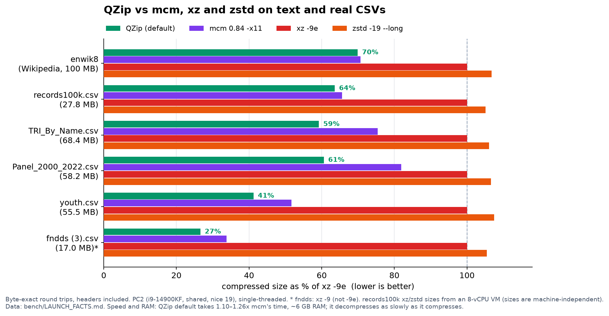
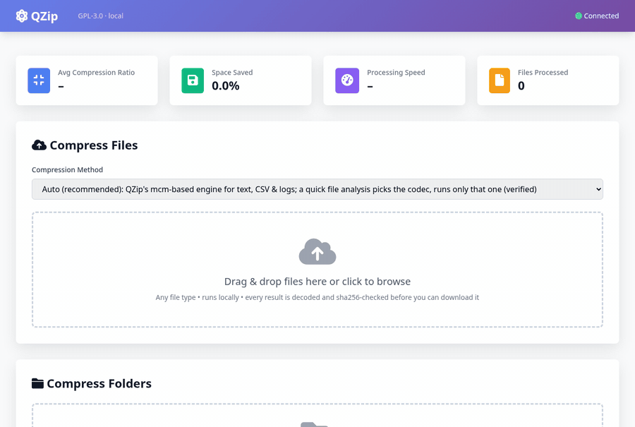
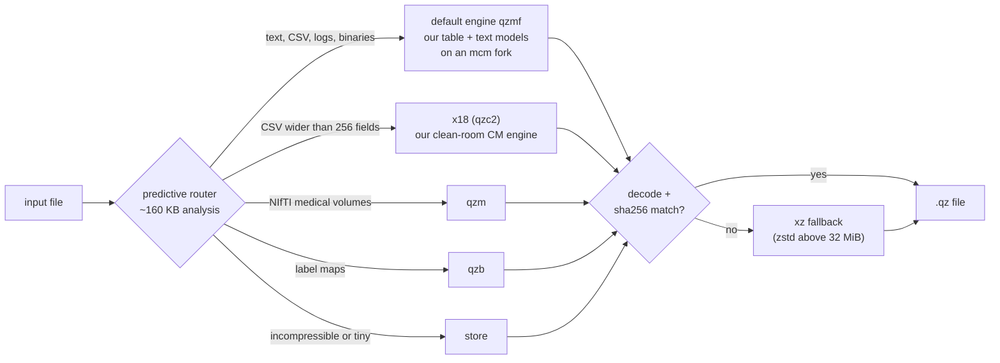

<h1 align="center">QZip</h1>

<p align="center">
  <b>Verified lossless compression that beats mcm on text and crushes xz and zstd on real-world CSVs.</b><br>
  One command or one drag-and-drop. Every file is decoded and sha256-checked before you get it.
</p>

<p align="center">
  <a href="https://github.com/EHankinson08/QZip/actions/workflows/ci.yml"></a>
  <a href="https://github.com/EHankinson08/QZip/releases/tag/v1.0.0"></a>
  <a href="LICENSE"></a>
  
</p>

<p align="center">
  <a href="#quick-start">Quick start</a> ·
  <a href="#benchmarks">Benchmarks</a> ·
  <a href="#how-it-works">How it works</a> ·
  <a href="#faq">FAQ</a> ·
  <a href="docs/BENCHMARKS.md">Full results</a>
</p>

<p align="center"></p>

QZip is a context-mixing compressor with models built for tables and text. On public CSV datasets it writes files
**20–26% smaller than mcm** and **1.65–3.8× smaller than xz -9e**, and on Wikipedia text it is **1.03–1.24% smaller
than mcm** and **30–35% smaller than xz, zstd and brotli**. It ships as a CLI and a local web app, runs entirely on
your machine, and never hands you a file it hasn't decoded and verified byte-for-byte.

## Highlights

- **Smaller files.** A table model that learns CSV/TSV columns as it reads them, plus tuned text contexts, on top of a
  proven context-mixing core.
- **Verified by construction.** Every result is decoded and its sha256 compared with the original before it is
  written. If that ever fails, QZip ships xz instead, so you can't get a broken file.
- **Picks the right engine for you.** A predictive router looks at ~160 KB of the file and chooses one codec. No trial
  encodes, one encode, one verifying decode.
- **Drag-and-drop web app.** `qzip web` opens a local UI on `127.0.0.1`. No account, no API key, nothing leaves your
  machine. Large files run as background jobs with progress and cancel.
- **One portable format.** CLI and web app write the same `.qz` container (a small JSON header plus the raw codec
  output), so either opens the other's files.
- **Honest numbers.** Every figure in this README is a byte-exact round trip with its machine, time and RAM recorded
  ([methodology](docs/BENCHMARKS.md)).

<p align="center"></p>

## Quick start

```bash
git clone https://github.com/EHankinson08/QZip.git && cd QZip
./run_local.sh                       # first run: venv + native build (~1–2 min), then the web app on http://127.0.0.1:5000
.venv/bin/qzip compress data.csv     # in a second terminal: writes data.csv.qz, verified
```

Get the file back with `.venv/bin/qzip decompress data.csv.qz -o restored.csv`, or drop the `.qz` on the web app.

**Requirements:** Linux on x86-64 with AVX2, Python 3.9+, gcc/g++ 13+ and make.

<details>
<summary>Manual install and Docker</summary>

```bash
python3 -m venv .venv && . .venv/bin/activate
pip install -e .          # small default install: numpy, zstandard, Flask, FastAPI (no torch)
make native               # builds the native codecs with the exact flags that were benchmarked
qzip web                  # local web app on http://127.0.0.1:5000
```

Docker: `docker build -t qzip . && docker run --rm -p 127.0.0.1:5000:5000 qzip`
</details>

### CLI

```bash
qzip compress   data.csv                     # -> data.csv.qz (default engine; -o to choose the name)
qzip compress   --max data.csv -o data.max.qz  # QZip's own x18 / qzs codecs: smallest on some files, 3x+ slower
qzip decompress data.csv.qz -o out.csv       # sha256-checked; refuses to overwrite without -f
qzip verify     data.csv.qz data.csv         # decodes and compares with the original
qzip info       data.csv.qz                  # header fields: name, source path, sha256
qzip bench      data.csv                     # QZip vs xz -9 / zstd -19 --long / bzip2 -9 on your file
qzip web                                     # local drag-and-drop web app
```

Modes: `auto` (default, the router), `--max` / `auto-max` (QZip's own codecs only, sometimes smaller, 3–15× slower)
and `auto-fast` (fast codecs only). Details in [docs/USAGE.md](docs/USAGE.md).

## Benchmarks

Sizes in bytes, smaller is better. Every row is a byte-exact round trip; a `.qz` file adds a header of under 1 KB.

| file | **QZip** (default) | mcm 0.84 -x11 | xz -9e | zstd -19 --long | brotli -11 |
|---|---:|---:|---:|---:|---:|
| enwik8 (Wikipedia, 100 MB) | **17,361,988** | 17,543,256 | 24,831,648 | 26,504,540 | 25,742,001 |
| enwik9 (Wikipedia, 1 GB) | **136,854,237** | 138,569,355 | – | – | – |
| records100k.csv (27.8 MB) | **5,098,228** | 5,261,158 | 8,018,604 | 8,427,879 | 7,893,616 |
| youth-dataset-long-form.csv (55.5 MB) | **1,435,856** | 1,798,461 | 3,482,548 | 3,743,251 | – |
| TRI_By_Name.csv (68.4 MB) | **4,254,555** | 5,418,808 | 7,182,196 | 7,618,709 | – |
| Panel_2000_2022.csv (58.2 MB) | **7,783,320** | 10,522,222 | 12,846,924 | 13,691,107 | – |
| fndds (3).csv (17.0 MB) | **193,851** | 246,276 | 728,608 (xz -9) | 768,113 | – |

**Speed and memory** (compress / decompress wall time, peak RAM):

| file | **QZip** (default) | mcm 0.84 -x11 | QZip `--max` (x18) | xz -9e | zstd -19 --long |
|---|---:|---:|---:|---:|---:|
| enwik8 | 44.5 / 44.2 s · 6.1 GB | 40.5 / 40.3 s · 6.1 GB | 139–144 / 145–150 s · 9.9 GB | 169.7 / 2.1 s · 0.7 GB | 128.5 / 0.27 s · 0.2 GB |
| enwik9 | 373.4 / 369.6 s · 6.2 GB | 336.0 / 333.0 s · 6.2 GB | 1,296.2 / 1,324.8 s · 12.0 GB | – | – |
| youth.csv | 10.1 / 10.8 s · 4.6 GB | 8.1 / 8.7 s | – | – | – |
| TRI_By_Name.csv | 18.1 / 19.3 s · 6.1 GB | 14.8 / 15.6 s | – | – | – |

**What this means**

- **Text:** 1.03% (enwik8) and 1.24% (enwik9) smaller than mcm at 1.10–1.11× its time and the same RAM; 30–35%
  smaller than xz, zstd and brotli.
- **CSVs:** 20–26% smaller than mcm on youth, TRI, Panel and fndds (3.1% on records100k) at 1.12–1.26× mcm's time.
- **The trade-off:** context mixing is slow and symmetric. QZip compresses *and* decompresses at about 2 MB/s on text;
  xz and zstd decompress in a second or two. Use QZip for archives and data you store more often than you read.
- **Not a record:** cmix/nncp-class compressors are smaller on enwik9 and far slower.

Method: Intel i9-14900KF (shared machine, `nice 19` + `ionice -c3`, one job at a time, single-threaded coders,
g++ 13.3), 21–24 Nov 2026. brotli and the records100k xz/zstd sizes were measured on an 8-vCPU VM (sizes do not depend
on the machine); the xz/zstd enwik8 times come from an earlier, more loaded session. Full tables, logs, NIfTI volumes,
charts and caveats: [docs/BENCHMARKS.md](docs/BENCHMARKS.md) and [bench/LAUNCH_FACTS.md](bench/LAUNCH_FACTS.md).

## How it works



The **default engine** starts from a fork of [mcm](https://github.com/mathieuchartier/mcm), Mathieu Chartier's
context-mixing compressor (GPL-3.0-or-later). The gains over mcm come from what we added: an adaptive CSV/TSV column
tracker with column-aware contexts and mixer weights, numeric profiles, and three text contexts from our x18 design
([src/engine_mcmfork/QZIP_FORK.md](src/engine_mcmfork/QZIP_FORK.md)). We also wrote our own engines from scratch:
**x18** (`qzc2`, clean-room context mixing), **qzs** (CSVs and logs), **qzb** (fast word transform + BWT) and **qzm**
(NIfTI). They run behind `--max`, and wherever the router predicts they win. The router, the `.qz` container with
sha256 verification and xz fallback, the web app and the CLI are QZip's own.

`src/safe_compress.py` is the single entry point for the CLI, web app and API: encode, decode, compare sha256, ship.

## FAQ

<details><summary><b>Is it really lossless?</b></summary>

Yes. Every output is decoded and compared with the original's sha256 before it is written; if the check fails, QZip
writes xz (zstd above 32 MiB) instead. `qzip decompress` checks the sha256 again, and `qzip verify` lets you
confirm any file yourself.
</details>

<details><summary><b>How slow is it?</b></summary>

About 2 MB/s on text (enwik8: 44 s each way) and 1.9–5.9 MB/s on CSVs, about 1.1–1.26× mcm's time. Decompression
takes as long as compression. `auto` never picks a codec slower than x18; `--max` is 3–15× slower than the default.
</details>

<details><summary><b>How much RAM does it need?</b></summary>

About 6 GB at the default level. QZip lowers the level to fit `--ram-mb` / `QZIP_RAM_MB` (default: 3/4 of your
RAM), to about 3 GB or 1.5 GB on smaller machines at some cost in size. x18 under `--max` uses up to 12 GB on enwik9.
</details>

<details><summary><b>Which files does it work on?</b></summary>

Best on CSV/TSV and other tables, logs and text. Any file round-trips. NIfTI medical volumes get their own codec
(qzm). Already-compressed data (JPEG, PNG, video, zip) gains nothing and is stored; for photos use JPEG XL
(`cjxl --lossless_jpeg=1`).
</details>

<details><summary><b>Why GPL-3.0?</b></summary>

The default engine is a fork of mcm, which is GPL-3.0-or-later, so QZip is too. Every original mcm header is kept;
see [NOTICE](NOTICE) and [THIRD_PARTY_NOTICES.md](THIRD_PARTY_NOTICES.md).
</details>

<details><summary><b>Can I host the web app publicly?</b></summary>

Not as is. The servers are development servers for local use (open CORS, pickle job store). For a hosted
deployment set `QZIP_REQUIRE_API_KEY=1`, `QUANTUM_API_KEY` and `QZIP_SECURE_COOKIES=1` behind HTTPS.
</details>

<details><summary><b>Is there anything quantum about it?</b></summary>

No. The "Q" is historical.
</details>

## Repository layout

| path | what |
|---|---|
| [`qzip/`](qzip/) | CLI, web launcher, job runner, `.qz` container |
| [`src/safe_compress.py`](src/safe_compress.py) | the verified entry point (encode → decode → sha256 → ship, else xz) |
| [`src/qzrouter.py`](src/qzrouter.py) | predictive router |
| [`src/engine_mcmfork/`](src/engine_mcmfork/) | default engine: our table and text models on an mcm fork |
| [`src/qzcore/`](src/qzcore/) | our clean-room codecs: x18 `qzc2`, `qzs`, `qzb`, `qzm` |
| [`webapp/`](webapp/) | local web app (Flask UI + FastAPI) |
| [`docs/`](docs/) | usage, benchmarks, charts |
| [`tests/`](tests/) | test suite (`pytest`) |

## Contributing

Bug reports, benchmark results on your data and pull requests are welcome. The one hard rule: nothing unverified
ships, so every change keeps every round trip byte-exact. See [CONTRIBUTING.md](CONTRIBUTING.md).

```bash
pip install -e ".[test]" && make native && python -m pytest -q
```

## License and credits

QZip is licensed under the [GNU General Public License v3.0 or later](LICENSE). QZip-authored code is Copyright 2026
Elliott Hankinson. The default engine is a fork of mcm 0.84 (Copyright (C) 2013 Google Inc., author Mathieu
Chartier, GPL-3.0-or-later). Bundled third-party code (libbsc/libsais under Apache-2.0; stock mcm and lpaq1 under GPL)
is listed in [THIRD_PARTY_NOTICES.md](THIRD_PARTY_NOTICES.md). Patent application U.S. 19/318,010 is pending; see
[PATENTS.md](PATENTS.md).

<sub>[Changelog](CHANGELOG.md) · [Security](SECURITY.md) · [The 2025 engines](docs/HISTORY_2025.md)</sub>
