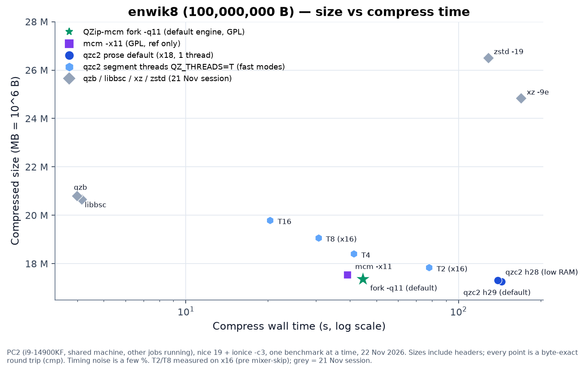
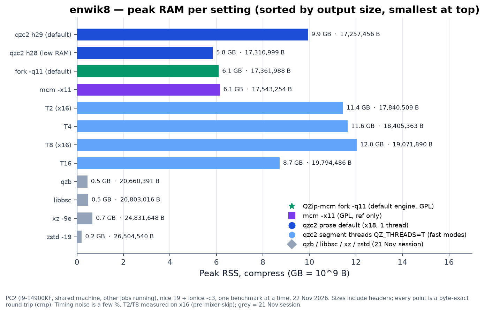
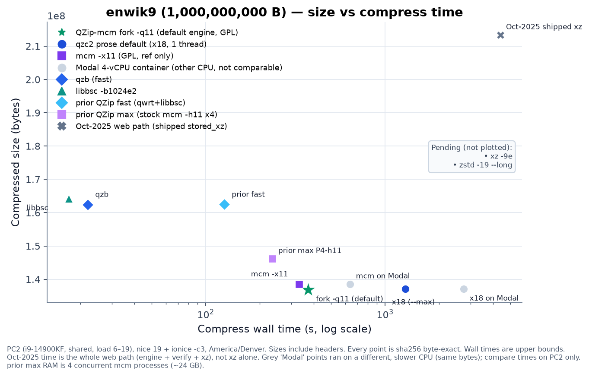
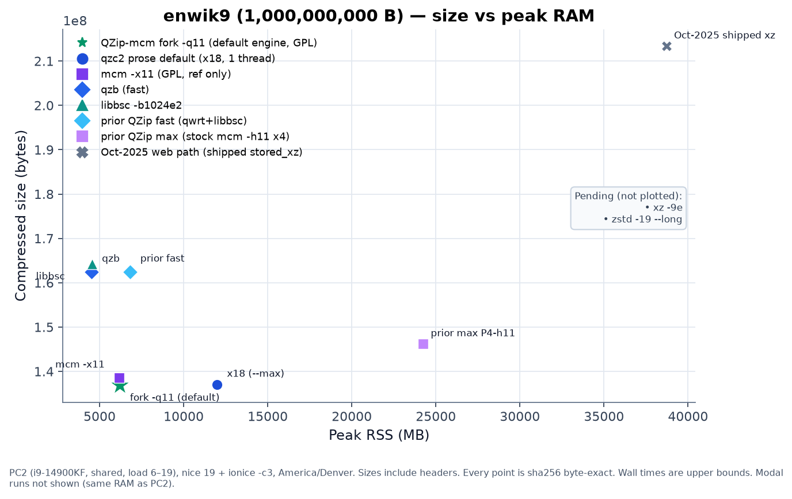
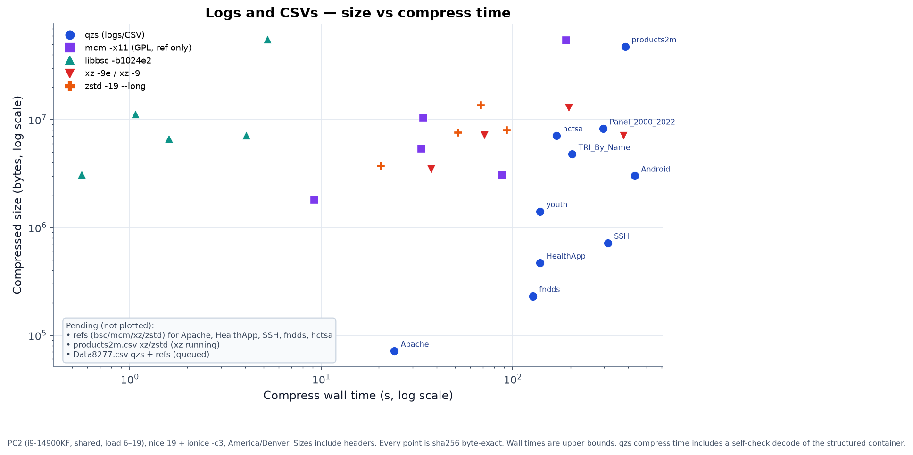
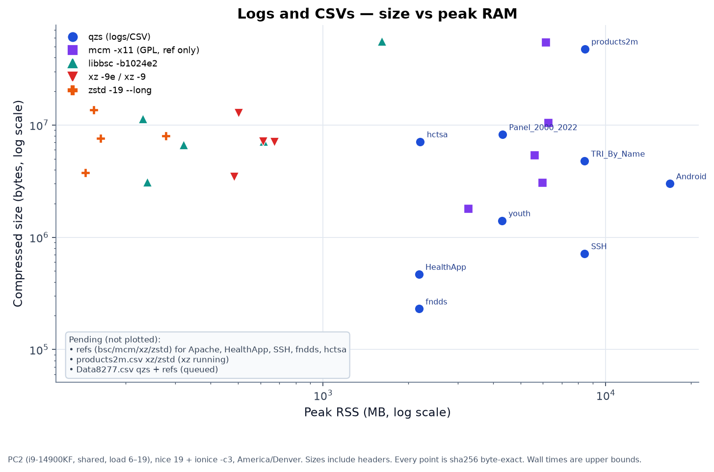
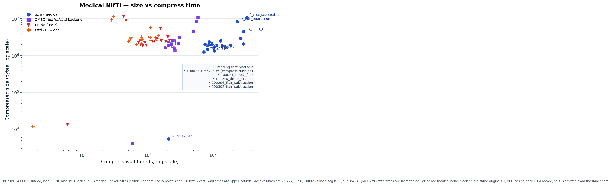
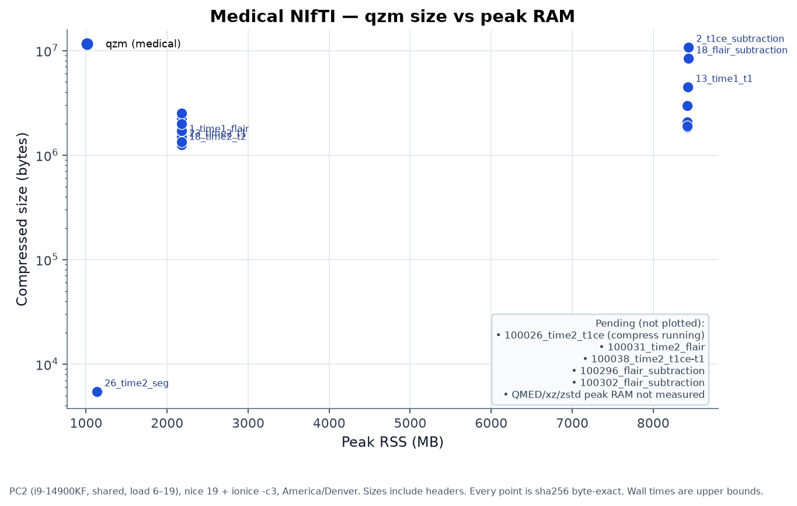

# QZip benchmark detail: qzcore engines (`--max`)

Methodology summary and the other docs: [docs/README.md](README.md). Charts are in `docs/charts/` (reproduce with `python3 docs/charts/make_qzcore_charts.py`).

## qzcore engine results (PC2, 21–23 Nov 2026; now the `--max` option)

qzcore is QZip's own engine, written without GPL code: **qzb** (fast: our word transform + our libbsc fork, Apache-2.0), **qzc** (max: clean-room context mixing), **qzs** (logs/CSVs: column transform + qzc), **qzm** (medical: QMED-style 3D predictor + qzcore backends). These numbers are from CLI runs on PC2 (i9-14900KF, shared machine, `nice 19` + `ionice -c3`). Since 24 Nov 2026 they are what `--max` (`auto-max`) runs; the default is the fork above.

Every size includes headers. Every finished row is a sha256 byte-exact round trip. Wall times are upper bounds under load. MB = 10^6 B. mcm is GPL-3.0 and is a reference only. Charts: [docs/charts/](charts/). Pending work is labelled pending and is not plotted as a point.

### enwik8 (100,000,000 B), re-measured 22 Nov 2026

Hardware and method: PC2 (Intel i9-14900KF, 32 logical CPUs). It is a shared machine with other people's jobs running, so every run was at `nice 19` + `ionice -c3`, one benchmark at a time. Wall times carry a few % of noise. Every row is a byte-exact round trip: `cmp` of the decoded file against enwik8, and for the 22 Nov hbits-28/T4/T16 runs also a sha256 match. Sizes are the whole file needed to decode, headers included. qzc2 is clean-room code (no mcm/paq/cmix source read or copied). mcm is GPL-3.0 and is used as a reference only.

| codec / setting | size B | vs mcm | c wall s | d wall s | peak RSS c (MB) | OK |
|---|---:|---:|---:|---:|---:|---|
| mcm 0.84 -x11 (GPL, reference only) | 17,543,254 | 0 | 39.2 | 38.0 | 6,148 | OK |
| **qzc2 prose default, hbits 29** (`qzc2 c in out auto 2 -m 12288`) | **17,257,456** | **−1.63%** | 139–144 | 145–150 | 9,936 | OK |
| qzc2 prose, hbits 28 (low RAM: `... -m 12288 28 2`) | 17,310,999 | −1.32% | 139.4 | 144.0 | 5,840 | OK |
| qzc2 fast mode `QZ_THREADS=2` (measured on x16*) | 17,840,509 | +1.69% | 78.0 | 80.8 | 11,445 | OK |
| qzc2 fast mode `QZ_THREADS=4` | 18,405,363 | +4.91% | 41.3 | 42.6 | 11,642 | OK |
| qzc2 fast mode `QZ_THREADS=8` (measured on x16*) | 19,071,890 | +8.71% | 30.6 | 30.9 | 12,034 | OK |
| qzc2 fast mode `QZ_THREADS=16` | 19,794,486 | +12.83% | 20.4 | 20.0 | 8,719 | OK |
| qzb (fast; 21 Nov session, heavier load) | 20,660,391 | +17.8% | 4.14 | 0.97 | 454 | OK |
| libbsc -b1024e2 (21 Nov) | 20,803,016 | +18.6% | 3.99 | 0.95 | 481 | OK |
| xz -9e -T1 (21 Nov) | 24,831,648 | +41.5% | 169.7 | 2.1 | 670 | OK |
| zstd -19 --long=27 -T1 (21 Nov) | 26,504,540 | +51.1% | 128.5 | 0.27 | 209 | OK |

\* x16 is the same model as the current default but without the mixer-update skip. Its single-thread enwik8 result was 17,281,177 B (+0.14% vs the default), so the T2/T8 rows are within about 0.1–0.2% of what the current build gives. T4 and T16 were re-measured on the current build. The qzc2 range is from three separate single-thread runs (q22, q23, q24).

Honest summary:
* **The qzc2 default is 1.63% smaller than mcm -x11 on enwik8**, and the low-RAM hbits-28 setting is still 1.32% smaller while using less memory than mcm (5.8 vs 6.1 GB).
* **It is also about 3.6× slower** (about 140 s against 39 s each way) and needs 9.9 GB at hbits 29.
* The segment-thread fast modes trade size for speed. Each thread codes its own segment with its own model, so they finish faster but compress worse. At 4 threads qzc2 is about as fast as mcm but 4.9% larger. At 16 threads it takes 20 s and is 12.8% larger. None of them beats mcm on size, and RAM rises because each segment has its own tables. The 1-thread default stays the "max" setting. See `QZ_THREADS` / `QZIP_QZC2_THREADS` in `src/qzcore/README.md`.

Older single-binary `qzc` rows for enwik8 (L2/L3, hbits 29/30, 21 Nov) are kept in `src/qzcore/RESULTS.md`. The mcm times in those rows (103 s) came from a much more heavily loaded session, so they are not comparable with the table above.

### enwik9 (1,000,000,000 B)

| codec | size | c wall s | d wall s | MB/s c | peak RSS MB | OK |
|---|---:|---:|---:|---:|---:|---|
| **qzb (fast)** | **162,445,705** | 21.97 | 5.95 | 45.5 | 4,532 | OK |
| libbsc -b1024e2 | 164,205,798 | 17.28 | 3.27 | 57.9 | 4,565 | OK |
| prior QZip fast (qwrt+libbsc, web path) | 162,473,695 | 126.7 | 39.7 | 7.89 | 6,816 | OK |
| prior QZip max, P4 × mcm -h11 (stock mcm, not qzcore) | 146,200,704 | 235.7 | 141.4 | 4.24 | ~24,240 (4×) | OK |
| Oct-2025 web path, shipped `stored_xz` | 213,370,900 | 4,390.7 (engine + verify + xz) | 9.03 | 0.228 | 38,711 | OK |
| Oct-2025 engine only (verified, not shipped; xz was smaller) | 250,131,976 | (same 4,390.7 s path) | — | — | (same run) | OK |
| **qzc2 max (x18 default `-m 12288 auto 2`), PC2, 23 Nov** | **137,076,090** | 1,296.2 | 1,324.8 | 0.772 | 11,968 | OK |
| mcm 0.84 -x11 (GPL, reference only), PC2, 23 Nov | 138,569,352 | 331.4 | 325.5 | 3.02 | 6,171 | OK |
| qzc2 max (x18), Modal 4-vCPU container, 23 Nov | 137,076,090 | 2,746.5 | 2,774.6 | 0.364 | 11,976 | OK |
| mcm -x11, Modal (same container type) | 138,569,352 | 639.3 | 687.7 | 1.56 | 6,177 | OK |
| qzc L2 auto (21 Nov run) | superseded by the qzc2 rows above; that result was never added here | | | | | |

**On enwik9, qzc2 is 1.08% smaller than mcm -x11 (137,076,090 vs 138,569,352 B) and about 3.9× slower on PC2** (and 0.16% larger than the default fork, which is 3.5× faster). It also uses about twice the RAM (12.0 vs 6.2 GB). On a Modal 4-vCPU container the same x18 build writes the same 137,076,090 B (sha 159b85351e5f76e6, matches the mcm round trip), in 2,746.5 s to compress and 2,774.6 s to decompress — about 4.30× and 4.03× slower than Modal mcm (639.3 s / 687.7 s), with peak RAM 11,976 MB. Every row is byte-exact: cmp on PC2, sha256 on Modal. On PC2 the jobs ran at nice 19 + ionice -c3, one at a time, at load 1.8–2.8. Details, the PC1 and THP measurements, and the opt-in size-push builds are in `src/qzcore/RESULTS.md`.

qzb is 1.07% smaller than libbsc on enwik9, uses similar RAM, and runs at 45.5 MB/s. The Oct-2025 path shipped xz at 213.4 MB after 73 minutes and 38.7 GB RAM; qzb is 24% smaller and about 200× faster.

### Logs and CSVs (`qzs`)

qzs compress time includes a self-check decode. On every file where mcm -x11 has finished, qzs is smaller and slower.

| file | orig B | qzs B | c s | d s | MB/s c | RSS MB | mcm -x11 | libbsc | xz -9e | zstd -19 | vs mcm | OK |
|---|---:|---:|---:|---:|---:|---:|---:|---:|---:|---:|---:|---|
| Apache.log | 5,135,876 | **71,316** | 24.1 | 13.5 | 0.213 | 612 | 75,836 (earlier) | pending | pending | pending | −6.0% | OK |
| HealthApp.log | 23,529,931 | **468,865** | 138.9 | 40.8 | 0.169 | 2,183 | pending | pending | pending | pending | — | OK |
| SSH.log | 73,417,506 | **716,603** | 313.4 | 202.4 | 0.234 | 8,424 | pending | pending | pending | pending | — | OK |
| Android.log | 192,270,829 | **3,003,705** | 433.6 | 573.8 | 0.443 | 16,843 | 3,081,546 | 7,182,224 | 7,093,892 | 7,997,164 | **−2.5%** | OK |
| fndds CSV | 24,057,371 | **230,391** | 127.2 | 4.5 | 0.189 | 2,185 | pending | pending | pending | pending | — | OK |
| hctsa CSV | 33,059,330 | **7,107,262** | 169.3 | 119.4 | 0.195 | 2,208 | pending | pending | pending | pending | — | OK |
| youth CSV | 55,547,651 | **1,408,094** | 138.8 | 7.1 | 0.400 | 4,294 | 1,798,464 | 3,103,426 | 3,482,548 | 3,743,251 | **−21.7%** | OK |
| TRI_By_Name CSV | 68,403,261 | **4,775,793** | 204.4 | 58.1 | 0.335 | 8,419 | 5,418,813 | 6,655,472 | 7,182,196 | 7,618,709 | **−11.9%** | OK |
| Panel_2000_2022 CSV | 58,192,381 | **8,230,962** | 296.7 | 24.7 | 0.196 | 4,313 | 10,522,226 | 11,317,634 | 12,846,924 | 13,691,107 | **−21.8%** | OK |
| products2m.csv | 326,108,495 | **47,643,116** | 387.0 | 166.3 | 0.843 | 8,437 | 54,780,824 | 55,599,448 | pending | pending | **−13.0%** | OK |
| Data8277.csv (23 Nov) | 857,672,667 | **6,215,661** | 776.8 | 209.7 | 1.104 | 16,933 | 10,300,412 | — | 30,534,864 (xz -9) | 45,330,414 | **−39.7%** | OK |
| fndds_ingredient_nutrient_value (3).csv (23 Nov) | 17,017,713 | **205,478** | 39.4 | 2.5 | 0.432 | 2,172 | 246,270 | — | 728,608 (xz -9) | 768,113 | **−16.6%** | OK |

### Medical NIfTI (`qzm`)

21 of 26 volumes are finished (all byte-exact). Bold in the full table in `src/qzcore/RESULTS.md` means qzm beat both QMED pass 2 and a byte-exact old artifact (or beat QMED when no exact artifact exists). 17 of those 21 meet that bar. Honest misses: three 100001 volumes beat QMED but lose to the old artifact; the 35.7 MB segmentation volume `100026_time2_seg` is 5,457 B vs QMED 4,106 B (**QMED wins by 32.9%**). Five volumes are still running or queued.

**Against standard codecs** (same volumes, PC2, 21 Nov 2026, every result sha256 byte-exact): qzm is smaller than
gzip -9, xz -9, zstd -19 --long=27, bzip2 -9 and brotli -11 on 20 of the 21 finished volumes. Totals over the twenty
71,424,352 B volumes: qzm 56,641,606 B; xz -9 67,630,616; bzip2 -9 69,058,235; brotli -11 69,357,093; zstd -19 --long
73,466,559; gzip -9 109,610,486. On `100026_time2_seg` bzip2 -9 (4,567 B) also beats qzm (5,457 B). The standard
codecs took at most 34.3 s to compress and 2.8 s to decompress any volume; their peak RAM was not recorded. README
chart: [`img/medical_size_vs_time.png`](img/medical_size_vs_time.png) (`python3 docs/img/make_medical_chart.py`).

| file (examples) | orig B | qzm B | QMED pass 2 | old artifact | c s | d s | RSS MB | OK |
|---|---:|---:|---:|---:|---:|---:|---:|---|
| 100001_time1_flair | 71,424,352 | **1,483,123** | 1,687,424 | 1,716,793 | 82.3 | 40.3 | 2,175 | OK |
| 100018_time2_t2 | 71,424,352 | **1,247,441** | 1,364,114 | 1,605,521 | 72.2 | 34.1 | 2,175 | OK |
| 100002_t1ce_subtraction | 71,424,352 | **10,780,836** | 10,970,930 | 11,666,574 | 331.9 | 162.7 | 8,434 | OK |
| 100026_time2_seg | 35,712,352 | 5,457 | **4,106** | — | 20.9 | 0.27 | 1,132 | OK |
| 100001_flair_subtraction | 71,424,352 | 1,856,589 | 2,023,970 | **1,820,830** | 113.7 | 48.7 | 2,174 | OK |

The complete per-file tables, including decompress times, remaining pending rows, and the measurement log, are in [`src/qzcore/RESULTS.md`](../src/qzcore/RESULTS.md). Reproduce the charts with `python3 docs/charts/make_qzcore_charts.py`.
