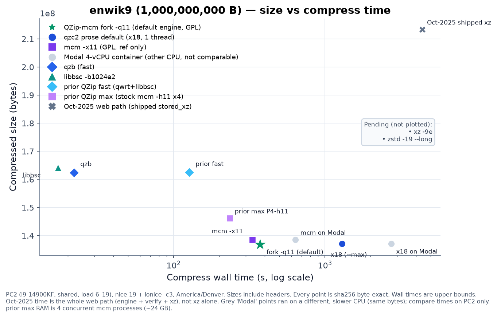

# Using QZip

Everything the [README](../README.md) leaves out: modes, the web app, configuration, the container format and the
full default-engine results.

## CLI and modes
```bash
pip install -e . && make native
qzip compress  data.csv                 # -> data.csv.qz   (default engine; -o out)
qzip compress  --max data.csv -o data.max.qz  # QZip's own x18 / qzs codecs: smallest on some files, 3x+ slower
qzip decompress data.csv.qz -o out.csv  # sha256-checked (default output data.csv; -f to overwrite)
qzip verify    data.csv.qz data.csv     # decodes and compares with the original
qzip bench     data.csv                 # QZip vs xz -9 / zstd -19 --long / bzip2 -9 (+ brotli -11 with .[bench])
qzip native                             # (re)build the native codecs = make native
```
CLI files and web-app downloads are the same `.qz` container (a small JSON header plus the raw codec output; see
`qzip/container.py`), so either one opens the other's files. Older `.qc.gz` / `.qc` files still open.

Modes (web UI drop-down, CLI `--mode`, API `mode`):
* `auto` (default): the predictive router (`src/qzrouter.py`, objective "balanced"). Text, CSV, logs and binaries go
  to the **default engine** (codec `qzmf`: our table and text models on the mcm fork, level `-q11`, ~6 GB RAM; the level drops to fit `--ram-mb` / `QZIP_RAM_MB`,
  default 3/4 of RAM). Predicted exceptions, decided from a ~160 KB analysis with no trial encodes: CSVs wider than the
  fork's 256-field table model (e.g. hctsa, ~10,000 columns) go to x18 (`qzc2`, 17.6% smaller there); NIfTI to `qzm`;
  label maps to `qzb`; incompressible or tiny files are stored. One encode, one verifying decode.
* `auto-max` (CLI `--max`, web "Max"): the previous default, QZip's own codecs only: x18 `qzc2` context mixing (prose
  gets the word dictionary), `qzs` for CSVs with text fields and field-delimited logs, `qzm` for NIfTI. Smallest on
  some files (enwik8 −0.6%, youth.csv −1.9%, HealthApp.log −8.9% vs the fork), but about 3x slower on text and up to
  ~15x slower on CSVs (qzs).
* `auto-fast`: same analysis, fast codecs only (qzb word transform + BWT, stored).
* 2025 modes `fast`, `max`, `ultra`, `legacy`, `hybrid`: the older engines (see [`docs/HISTORY_2025.md`](HISTORY_2025.md)).
  They need `pip install -e ".[legacy]"` (torch, numba, scipy, ...); so does opening a `.qc` file made by the 2025
  web app. `text`: optional `src/qzip_text.py` hook.
If the chosen result does not decode byte-exact, QZip falls back to xz (zstd above 32 MiB); nothing unverified ships.

Native codecs: `make native` (needs gcc/g++/make and an AVX2 CPU; `run_local.sh` and the Docker image run it). It
builds the default engine `src/native/qzmf` (from `src/engine_mcmfork/`, with exactly the flags that were
benchmarked), QZip's own codecs in `src/qzcore/`, and the libbsc / mcm / lpaq1 helpers.

Tests: `pip install -e ".[test]" && pytest`. Tests of the 2025 modes skip unless the `[legacy]` extra is installed;
set `QZIP_DATA_DIR` (showcase CSVs/logs) and `QZIP_ENWIK8` to run the data-dependent ones.

## Web app
* `./run_local.sh` (or `pip install -e . && make native && qzip web`) starts two local processes: the API server
  (`webapp/api.py`, 127.0.0.1:8000) and the web UI (`webapp/ui.py`, 127.0.0.1:5000).
* Large files run as background jobs with progress and cancel. There is no hard timeout unless you set
  `QZIP_COMPRESS_TIMEOUT` (seconds). Uploads stream to disk. `/api/compress` waits and returns JSON unless you pass
  `async=1`.
* Key checks are off unless you set `QZIP_REQUIRE_API_KEY=1` (for a hosted deployment, then also set
  `QUANTUM_API_KEY` and `QZIP_SECURE_COOKIES=1` behind HTTPS). The servers are development servers for local use; do
  not expose them publicly.
* Docker: `docker build -t qzip . && docker run --rm -p 127.0.0.1:5000:5000 qzip`

## Architecture and container
`src/safe_compress.py` is the single entry point used by the web app, API and CLI. It is a **check-only** layer:
it runs one encoder (default `auto`: the predictive router `src/qzrouter.py`, usually the default engine `qzmf` (our models on the mcm fork); `fast`/`max`/`ultra`: the Oct-2025 engine, see `docs/HISTORY_2025.md`), decodes the result, compares
sha256, and only if that fails falls back to xz (zstd above 32 MiB). The container is JSON
`{compressed_data, reconstruction_metadata, method, quantum_parameters{qzip:{orig_sha256, orig_size, decoder,
mode, detected_type, chosen, route, fallback}}, ...}`; the `.qz` file stores it as a JSON header followed by the raw payload. The web UI shows the detected type and
the method used for each file.

## Default engine in detail: QZip's table and text models on an mcm fork (24 Nov 2026)

`src/engine_mcmfork/` starts from a fork of mcm 0.84 (Mathieu Chartier, GPL-3.0-or-later; every original header kept).
The gains come from QZip's additions: an adaptive CSV/TSV tracker with table contexts (field index, byte and value
above in the same field, previous field) and a `-q` level that swaps three weak text contexts for ones from QZip's
x18 design. Details and the A/B log:
[`src/engine_mcmfork/QZIP_FORK.md`](../src/engine_mcmfork/QZIP_FORK.md), [`bench/RESULTS.md`](../src/engine_mcmfork/bench/RESULTS.md).

PC2 (i9-14900KF, shared machine, `nice 19` + `ionice -c3`, one job at a time, g++ 13.3), 23 Nov 2026. Every row is a
byte-exact round trip (cmp). Times are compress / decompress wall seconds, RAM is peak RSS.

| file | **fork -q11 (default)** | stock mcm -x11 | QZip x18 `qzc2` (`--max`) | qzs (`--max`, CSV/logs) |
|---|---:|---:|---:|---:|
| enwik8 (100 MB) | **17,361,988** · 44.5 / 44.2 s · 6.1 GB | 17,543,256 · 40.5 / 40.3 s · 6.1 GB | 17,257,456 · 139–144 / 145–150 s · 9.9 GB | – |
| enwik9 (1 GB, run once) | **136,854,237** · 373.4 / 369.6 s · 6.2 GB | 138,569,355 · 336.0 / 333.0 s · 6.2 GB | 137,076,090 · 1,296.2 / 1,324.8 s · 12.0 GB | – |
| youth.csv (55.5 MB) | **1,435,856** · 10.1 / 10.8 s · 4.6 GB | 1,798,461 · 8.1 / 8.7 s | – | 1,408,094 · 139 / 7 s |
| TRI_By_Name.csv (68.4 MB) | **4,254,555** · 18.1 / 19.3 s · 6.1 GB | 5,418,808 · 14.8 / 15.6 s | – | 4,775,793 · 204 / 58 s |
| Panel_2000_2022.csv (58.2 MB) | **7,783,320** · 19.2 / 19.7 s · 6.3 GB | 10,522,222 · 15.7 / 16.6 s | – | 8,230,962 · 297 / 25 s |
| fndds (3).csv (17.0 MB) | **193,851** · 2.9 / 2.9 s · 3.3 GB | 246,276 · 2.3 / 2.4 s | – | – |
| records100k.csv (27.8 MB) | **5,098,228** · 14.3 / 15.2 s · 6.1 GB | 5,261,158 · 12.8 / 13.0 s | – | – |
| hctsa.csv (33.1 MB, ~10,000 columns) | 8,510,953 · 13.3 / 13.9 s · 6.3 GB | 8,510,968 · 12.3 / 12.9 s | **7,009,669** · 44.7 / 46.0 s · 9.4 GB ← `auto` routes here | 7,107,262 · 169 / 119 s |

* **Text:** the fork is 1.03% (enwik8) and 1.24% (enwik9) smaller than mcm at 1.10–1.11× mcm's time and the same RAM.
  Against QZip x18 on the same machine it is 0.61% *larger* on enwik8 but 0.16% *smaller* on enwik9, and 3.1–3.5×
  faster with about half the RAM (6.2 vs 12.0 GB).
* **Modal caveat:** x18 enwik9 was also run on a Modal 4-vCPU container: same 137,076,090 B, but 2,746.5 / 2,774.6 s
  on a different, slower CPU (Modal mcm took 639.3 s there). The fork's own notes compared against that Modal time
  ("about 7× faster"); on the same machine (PC2) the honest figure is **3.5×**.
* **CSVs:** 20–26% smaller than mcm on youth/TRI/Panel/fndds, 3.1% on records, 1.12–1.26× mcm's time. It beats qzs on
  TRI (−10.9%) and Panel (−5.4%), loses on youth (+2.0%), and is 11–15× faster than qzs.
* **Ragged / very wide CSVs:** the fork's table model tracks at most 256 fields, so hctsa gains nothing. `auto`
  predicts this from the field count and uses x18 (−17.6% vs the fork, 3.4× slower). It never picks qzs for the
  default, because qzs is slower than x18 (0.2 vs 0.7 MB/s).
* **Logs (box, 8-core VM, loaded):** Apache.log fork 71,861 B (qzs 71,316; mcm 75,836); HealthApp.log fork 514,724 B
  in 36 s (qzs 468,865 B, −8.9%, in 139 s on PC2). `auto` keeps logs on the fork; `--max` gets the qzs result.
* **Speed rule:** no `auto` route is slower than x18: the fork runs at 2.2–2.7 MB/s on text and 1.9–5.9 MB/s on CSVs (x18: ~0.7 MB/s), the
  wide-CSV exception *is* x18, and the medical / stored routes are unchanged.



## When not to use QZip
- **Ordinary images (JPEG/PNG/photos):** QZip does not compress them losslessly (output is about the
  original size). Use JPEG XL (`cjxl --lossless_jpeg=1` for JPEG), WebP/JXL lossless for graphics, AVIF/JXL lossy.
- **Generic text, most logs:** before Nov 2026 zstd/xz/brotli were better; the default engine (context mixing) now
  beats them by a wide margin, at context-mixing speed (~2 MB/s).
- **RL-neural log path** (flag `0x80`): needs a ~12.8 GB external model; never shipped.
